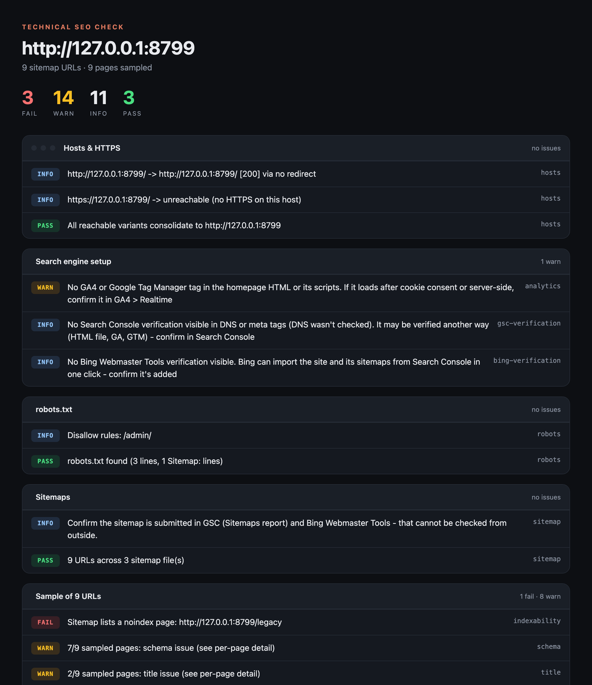
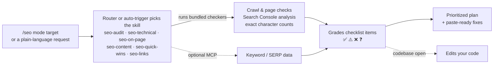

<p align="center">
  
</p>

<p align="center">
  <a href="https://github.com/Moncef12/seo-checklist-skills/actions/workflows/ci.yml"></a>
  
  
  
</p>

# SEO Checklist Skills for Claude

The **40-point SEO checklist** as Claude skills. Type `/seo https://yoursite.com`, or just ask Claude about your site's SEO. It checks the real site, grades every checklist item honestly, and hands back a prioritized plan with paste-ready fixes. If your codebase is open, Claude can make the fixes too.

Under the skills are checkers with no dependencies that do the parts Claude can't eyeball reliably: crawling, near-duplicate detection, title widths in pixels, schema rules per type, analytics and verification footprints. They also run on their own, as an HTML report or a CI gate.

Works in **Claude Code** (plugin) and **Claude.ai / Claude Desktop** (uploaded skills).

## Usage

In Claude Code, everything goes through one command router, `/seo`:

```text
/seo                           → Show all available commands
/seo {url}                     → AUTO: full 40-point audit + prioritized report
/seo audit {url}               → Full audit: technical, on-page, content, quick wins, links
/seo technical {url}           → Crawl, indexing, sitemaps, canonicals, redirects, schema
/seo page {url|file} [keyword] → On-page review of one page + rewrites
/seo rewrite {url|file} {kw}   → Title, meta, H1 and intro rewrites only (exact char counts)
/seo gsc {export.zip}          → Search Console quick wins: low CTR, page 2, questions
/seo titles {query_page.csv}   → Titles that miss their top query or get cut off (~600 px)
/seo decliners {compare.zip}   → Pages losing traffic: diagnosis + refresh plan
/seo content {domain|topic}    → Content plan: competitor gaps, low-KD keywords, clusters
/seo cannibal {data|keyword}   → Pages competing for one keyword → merge/redirect plan
/seo dupes {url|files}         → Near-duplicate pages and repeated paragraphs
/seo compare {competitor}      → "X vs Y", alternatives and "best X" page briefs
/seo links {domain}            → Link plan: mentions, backlink gap, "best X" lists, Reddit
/seo local {business}          → Google Business Profile + local schema
/seo schema {url|file}         → Ready-to-paste JSON-LD for a page
/seo cwv {url}                 → Core Web Vitals diagnosis + stack-specific fixes
/seo report {url}              → Styled HTML report of the technical check
/seo checklist [url]           → Track the 40 items in SEO-CHECKLIST.md, run after run
/seo fix                       → Apply the audit's fixes in your codebase
/seo ci {url}                  → Add the SEO checker as a CI gate (GitHub Action or any CI)
```

**Or just ask in plain words.** The six skills load on their own when your request matches:

```text
Why isn't my new blog post showing up in Google? It's been 3 weeks.
Here's my Search Console export. What should I fix first?
Our organic clicks dropped 30% last month. Here's the compare export - what happened?
Plan a topic cluster around "freelance invoicing" and tell me which pages to write first.
```

Give Claude whatever you have: a URL, a Search Console `.zip`, pasted HTML, a file in your repo, or the whole codebase. After an audit, `/seo fix` (or "fix the issues you found") edits titles, canonicals, sitemaps and schema through your framework (Next.js, Nuxt, Astro, SvelteKit, WordPress).

- If a keyword or SERP tool is connected as an MCP server (DataForSEO, Ahrefs, Semrush), the skills use it for volumes, keyword difficulty, competitors and "People also ask". Without one, they say what's unknown instead of inventing numbers.
- Anything Claude can't verify from outside, like your GSC setup or backlink profile, is marked ❓ with the exact data needed to settle it.
- In Claude.ai and Claude Desktop, there are no slash commands. Just ask, and the skills load the same way.

## See it in action

> **You:** Can you make this page rank better for "invoice software for freelancers"? *(pastes the page's HTML)*

**Claude** loads `seo-on-page` and replies:

> | Item | Status | Finding | Do |
> |---|---|---|---|
> | O2 Title | ❌ | "Home" (4 chars): no keyword and no reason to click | Use one of the rewrites below (50–60 chars) |
> | O4 Headings | ❌ | There's no H1; the page opens with an H2 | Change it to a single `<h1>` that contains the keyword |
> | O5 First 2 lines | ❌ | "In today's fast-paced world…" is filler | Open with what the product is and who it's for |
> | O6 Image | ❌ | `/hero.png` has no alt text, no width/height, a generic filename and uses PNG | See the fix below |
>
> | | Current (chars) | Option A (chars) | Option B (chars) |
> |---|---|---|---|
> | Title | Home (4) | Invoice Software for Freelancers: Get Paid Faster \| Acme (56) | Invoice Software for Freelancers - Get Paid on Time \| Acme (58) |
>
> *…followed by meta descriptions, a new H1 and intro, paste-ready HTML and internal links to add.* **[Full conversation →](examples/conversations/02-on-page-rewrite.md)**

### Real conversations

These are unedited transcripts recorded with the plugin installed. "Acme Invoice" is a fictional demo company.

| You ask… | Skill | What you get |
|---|---|---|
| ["Audit the SEO of our site before launch. Here's a GSC export from the old domain."](examples/conversations/01-full-site-audit.md) | `seo-audit` | A 40-item scorecard, top 10 priorities, rewrites, a redirect map and schema, all in one report |
| ["Make this page rank for *invoice software for freelancers*."](examples/conversations/02-on-page-rewrite.md) | `seo-on-page` | Graded on-page items, rewrites with verified character counts, paste-ready HTML |
| ["Here's my Search Console export. What should I fix first?"](examples/conversations/03-search-console-quick-wins.md) | `seo-quick-wins` | Fixes ranked by estimated missed clicks, page-2 pages to push, and an honest "this export can't show decliners, here's the one you need" |
| ["Two of our pages keep swapping places for *invoice template*."](examples/conversations/04-keyword-cannibalization.md) | `seo-content` | The owner URL, a merge-or-change-focus check, and a redirect table with the content to keep |
| ["I blocked /old-blog/ in robots.txt but the posts are still in Google."](examples/conversations/05-technical-deindex.md) | `seo-technical` | Why it happens, Next.js code for noindex, 410 or 301, and why FAQ schema won't get the dropdowns |
| ["Should I buy 500 backlinks on Fiverr and make some Reddit accounts?"](examples/conversations/06-link-building.md) | `seo-links` | The real risks, then a concrete link plan: directories, "best X" lists, backlink gap, open Reddit participation |

## What the checkers find that a quick look misses

| Checklist item | What runs | Example finding |
|---|---|---|
| **Q2** `site:` check | `gsc_analyze.py titles` pairs each page with its top Search Console query and reads the live title | "HOW TO WRITE AN INVOICE THAT GETS PAID: WORKER CHECKLIST" is 56 characters but ~678 px, so Google cuts it |
| **C4** thin or overlapping pages | `site` compares the main text of every crawled page (nav and footer ignored) | /locations/austin and /locations/round-rock are 91% the same text: a city-swap doorway pair |
| **T1, T2** GSC, GA4 and Bing | `site` reads the homepage, its own JavaScript bundles and public DNS | GA4 found in `/_next/static/chunks/…js` (loaded by JavaScript); Search Console verified by DNS; Bing not verified |
| **T13** schema | `page` applies Google's required properties per type | Product "Payly Pro" is missing offers or review or aggregateRating: valid JSON, but no rich result |
| **O6** images | `page` weighs every image without downloading it | /img/hero.png is 341 KB: compress it and serve WebP/AVIF |

### HTML report

Add `--html report.html` to any run (or type `/seo report <url>`) for a self-contained report you can open offline or attach to a ticket:

<p align="center"></p>

### Track progress

`/seo checklist` keeps a living `SEO-CHECKLIST.md` in your project: the 40 items by section, a progress bar, and what improved or regressed since the last run. Tick a box by hand when you fix something the audit can't see, and the next run keeps it.

```markdown
**Progress: 14/39 done (36%)** `███████░░░░░░░░░░░░░`
❌ 3 failing · ⚠️ 6 need work · ❓ 16 unknown · ➖ 1 not applicable

Improved:
- **T5** Add canonical tags: ❌ → ✅ Pass
Got worse:
- **T3** Fix indexing issues: ✅ → ❌ Fail
```

### CI gate

Fail a deploy when SEO breaks (a stray `noindex`, a dropped canonical, broken links, a sitemap listing 404s):

```yaml
- uses: Moncef12/seo-checklist-skills@v1.2.0
  with:
    url: https://staging.example.com
    fail-on: FAIL          # WARN for a stricter gate, none to only report
```

The action writes the report to the job summary, uploads `report.html`, `report.md` and `counts.json`, and exposes `fail-count` and `warn-count` as outputs. Any other CI can run `python3 shared/seo_check.py site "$URL" --fail-on FAIL --html seo-report.html`.

## Skills

| Skill | Covers | Loads when you say things like |
|---|---|---|
| **seo** *(router)* | The `/seo` command menu. It dispatches each mode to the skills below. | Only when you type `/seo …` |
| **seo-audit** | All 40 checklist items in one prioritized report | "audit my SEO", "why am I not ranking?", "get this site SEO-ready" |
| **seo-technical** | GSC/GA4 · sitemaps · indexing · robots/noindex · canonicals · Core Web Vitals · mobile · JS crawlability · broken links/redirects · clean URLs · breadcrumbs · orphans · schema | "pages aren't indexed", "fix my sitemap", "canonical issues", "PageSpeed is bad" |
| **seo-on-page** | Search intent · titles 50-60 chars · unique meta descriptions · headings · answer in the first 2 lines · images/alt · internal links | "make this page rank", "rewrite my title and meta", "is this post optimized?" |
| **seo-content** | Competitor keywords · high-volume/low-KD · cannibalization · merge thin pages · topic clusters · feature & use-case pages · comparisons/alternatives · listicles · E-E-A-T · dateModified | "what should we write?", "keyword research", "two pages compete", "plan an alternatives page" |
| **seo-quick-wins** | Low CTR · `site:` title check · page-2 pages · People Also Ask · decliners | "here's my GSC export", "quick wins", "why did traffic drop?" |
| **seo-links** | Brand mentions · backlink gap · "best X" lists · Reddit threads · Google Business Profile | "how do I get backlinks?", "link building plan", "rank on Google Maps" |

## Install

**Claude Code**
```text
/plugin marketplace add Moncef12/seo-checklist-skills
/plugin install seo-checklist@seo-checklist-skills
```
Then type `/seo` to see the commands. If another plugin also defines `/seo`, use `/seo-checklist:seo`.

**Claude.ai / Claude Desktop:** download the skill zips from the [latest release](https://github.com/Moncef12/seo-checklist-skills/releases/latest), then upload them in **Settings > Capabilities > Skills**.

### Try it on the demo site

The repo includes a small fictional site with 10 planted SEO problems. Start it with `make demo`, then run `/seo http://127.0.0.1:8799` in Claude Code. Compare the result with the [recorded audit](examples/conversations/01-full-site-audit.md).

## How it works



Each skill pairs Claude's judgment (search intent, priorities, rewrites) with small bundled checkers for the parts that must be exact: crawling, parsing, counting, comparing pages and applying schema rules. The checkers need nothing installed (Python 3.9+ standard library). If code can't run, as in Claude.ai without code execution, the skills apply the same rules by hand.

## Quality

- **Behavioral evals:** 12 realistic requests, each run 3× with and without the plugin and graded by a Sonnet judge. The plugin scores **0.93 against 0.71** for the baseline (+0.23) and never scores lower. It lifted 8 of 12 cases, with the biggest gains on rewrites (+1.00), full audits, link plans and de-indexing (+0.33 each). The right skill loaded in **33/33** SEO runs and **0/3** times on a Google Ads near-miss. v1.2 adds 5 harder cases, such as a title cut off by pixel width at 56 characters and a city-swap doorway pair among 22 pages. Details and caveats: [`evals/RESULTS.md`](evals/RESULTS.md).
- **48 offline tests,** including an end-to-end run against the demo site and a stress test of the duplicate detection, on Python 3.9, 3.11 and 3.13 in CI. CI also runs the GitHub Action itself against the demo site, `claude plugin validate --strict` and lint.
- **Tested on live production sites** (Next.js on Vercel and Netlify). Those runs caught three bugs before release: GA4 tags loaded from JavaScript bundles, a crawl that followed an off-site redirect, and over-eager repeated-paragraph warnings.

<details>
<summary><b>For developers: the bundled checkers, CI usage, project layout</b></summary>

The skills call these standard-library Python scripts (copies live in each skill's `scripts/` folder). You can also run them yourself, for example as a CI gate that fails a deploy on SEO regressions:

```yaml
- run: python3 skills/seo-technical/scripts/seo_check.py site "$PREVIEW_URL" --crawl 200 --fail-on FAIL
```

| Script | Command | Useful flags |
|---|---|---|
| `seo_check.py` | `site URL` | `--sample N` · `--crawl N` · `--images` · `--no-dns` · `--delay S` · `--workers N` · `--json` · `--html PATH` · `--counts PATH` · `--fail-on FAIL\|WARN` |
| `seo_check.py` | `page URL_OR_FILE...` | `--psi` (Core Web Vitals, optional `PSI_API_KEY`) · `--no-images` · `--json` · `--html PATH` · `--fail-on` · several files are compared with each other |
| `gsc_analyze.py` | `quick-wins \| decliners \| cannibalization \| titles PATH` | `--min-impressions` · `--top` · `--swap` · `--html-dir DIR --base URL` (titles from a static build) · `--json` |
| `checklist.py` | `init \| update \| show` | `--statuses FILE` or `--set ID=STATUS[:note]` · `--file SEO-CHECKLIST.md` · `--site URL` |
| `lengths.py` | `--title "..." --meta "..."` | Exact character counts plus a pixel-width estimate |

The crawler obeys robots.txt and never leaves the site, even when an internal URL redirects elsewhere. The GSC analyzer reads localized exports (EN/FR/DE/ES/PT/IT/NL). `--color always|never` controls terminal badges (auto by default). Sample raw outputs are in [`examples/under-the-hood/`](examples/under-the-hood/).

```bash
make sync       # copy every shared/*.py module into the skills that run scripts
make test       # unit + integration tests (offline)
make lint       # ruff
make validate   # claude plugin validate --strict
make demo       # serve the demo site
make eval       # behavioral evals, with vs. without the plugin
make package    # dist/<skill>.zip for Claude.ai
```

See [CONTRIBUTING.md](CONTRIBUTING.md) for the layout and the skill-writing conventions.

</details>

## Credits

The checklist is adapted from **"The only SEO checklist you'll need"** by [Okara](https://okara.ai). The skills, scripts and guidance in this repo are independent work and are not affiliated with or endorsed by Okara.

## License

[MIT](LICENSE) © Moncef Hassein-bey
