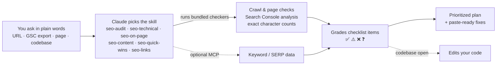

<p align="center">
  
</p>

<p align="center">
  <a href="https://github.com/Moncef12/seo-checklist-skills/actions/workflows/ci.yml"></a>
  
  
  
</p>

# SEO Checklist Skills for Claude

The **40-point SEO checklist** as six Claude skills. You don't learn any commands. Just ask Claude about your site's SEO, and the right skill loads, checks the real site, and hands back a prioritized plan with paste-ready fixes. If your codebase is open, Claude can make the fixes too.

Works in **Claude Code** (plugin) and **Claude.ai / Claude Desktop** (uploaded skills).

## Just ask

> **You:** Can you make this page rank better for "invoice software for freelancers"? *(pastes the page's HTML)*

**Claude** loads `seo-on-page` and replies:

> | Item | Status | Finding | Do |
> |---|---|---|---|
> | O2 Title | ❌ | "Home" (4 chars): no keyword and no reason to click | Use one of the rewrites below (50–60 chars) |
> | O4 Headings | ❌ | There's no H1; the page opens with an H2 | Change it to a single `<h1>` that contains the keyword |
> | O5 First 2 lines | ❌ | "In today's fast-paced world…" is filler | Open with what the product is and who it's for |
> | O6 Image | ❌ | `/hero.png` has no alt text, no width/height, a generic filename and uses PNG | See the fix below |
>
> | | Current (chars) | Option A (chars) | Option B (chars) |
> |---|---|---|---|
> | Title | Home (4) | Invoice Software for Freelancers: Get Paid Faster \| Acme (56) | Invoice Software for Freelancers - Get Paid on Time \| Acme (58) |
>
> *…followed by meta descriptions, a new H1 and intro, paste-ready HTML and internal links to add.* **[Full conversation →](examples/conversations/02-on-page-rewrite.md)**

### More real conversations

These are unedited transcripts recorded with the plugin installed. "Acme Invoice" is a fictional demo company.

| You ask… | Skill | What you get |
|---|---|---|
| ["Audit the SEO of our site before launch. Here's a GSC export from the old domain."](examples/conversations/01-full-site-audit.md) | `seo-audit` | A 40-item scorecard, top 10 priorities, rewrites, a redirect map and schema, all in one report |
| ["Make this page rank for *invoice software for freelancers*."](examples/conversations/02-on-page-rewrite.md) | `seo-on-page` | Graded on-page items, rewrites with verified character counts, paste-ready HTML |
| ["Here's my Search Console export. What should I fix first?"](examples/conversations/03-search-console-quick-wins.md) | `seo-quick-wins` | Fixes ranked by estimated missed clicks, page-2 pages to push, and an honest "this export can't show decliners, here's the one you need" |
| ["Two of our pages keep swapping places for *invoice template*."](examples/conversations/04-keyword-cannibalization.md) | `seo-content` | The owner URL, a merge-or-change-focus check, and a redirect table with the content to keep |
| ["I blocked /old-blog/ in robots.txt but the posts are still in Google."](examples/conversations/05-technical-deindex.md) | `seo-technical` | Why it happens, Next.js code for noindex, 410 or 301, and why FAQ schema won't get the dropdowns |
| ["Should I buy 500 backlinks on Fiverr and make some Reddit accounts?"](examples/conversations/06-link-building.md) | `seo-links` | The real risks, then a concrete link plan: directories, "best X" lists, backlink gap, open Reddit participation |

## The six skills

| Skill | Covers | Loads when you say things like |
|---|---|---|
| **seo-audit** | All 40 items in one prioritized report | "audit my SEO", "why am I not ranking?", "get this site SEO-ready" |
| **seo-technical** | GSC/GA4 · sitemaps · indexing · robots/noindex · canonicals · Core Web Vitals · mobile · JS crawlability · broken links/redirects · clean URLs · breadcrumbs · orphans · schema | "pages aren't indexed", "fix my sitemap", "canonical issues", "PageSpeed is bad" |
| **seo-on-page** | Search intent · titles 50-60 chars · unique meta descriptions · headings · answer in the first 2 lines · images/alt · internal links | "make this page rank", "rewrite my title and meta", "is this post optimized?" |
| **seo-content** | Competitor keywords · high-volume/low-KD · cannibalization · merge thin pages · topic clusters · feature & use-case pages · comparisons/alternatives · listicles · E-E-A-T · dateModified | "what should we write?", "keyword research", "two pages compete", "plan an alternatives page" |
| **seo-quick-wins** | Low CTR · `site:` title check · page-2 pages · People Also Ask · decliners | "here's my GSC export", "quick wins", "why did traffic drop?" |
| **seo-links** | Brand mentions · backlink gap · "best X" lists · Reddit threads · Google Business Profile | "how do I get backlinks?", "link building plan", "rank on Google Maps" |

## Install

**Claude Code**
```text
/plugin marketplace add Moncef12/seo-checklist-skills
/plugin install seo-checklist@seo-checklist-skills
```

**Claude.ai / Claude Desktop:** download the skill zips from the [latest release](https://github.com/Moncef12/seo-checklist-skills/releases/latest), then upload them in **Settings > Capabilities > Skills**.

## Using it

Describe what you want in plain words and give Claude whatever you have:

- **A URL.** "Audit https://example.com. The pages that matter are /pricing and /blog."
- **A Search Console export.** Drop in the `.zip` from Performance > Export and ask "what should I fix first?"
- **A page.** Paste the HTML or text, or point to the file: "optimize `app/blog/[slug]/page.tsx` for *invoice software*".
- **Your codebase.** After an audit, say "fix the issues you found". Claude edits titles, canonicals, sitemaps and schema through your framework (Next.js, Nuxt, Astro, SvelteKit, WordPress).

A few more prompts to try:

```text
Why isn't my new blog post showing up in Google? It's been 3 weeks.
Plan a topic cluster around "freelance invoicing" and tell me which pages to write first.
Write a fair "Acme vs FreshBooks" comparison page brief.
Our organic clicks dropped 30% last month. Here's the compare export - what happened?
Find link opportunities: who links to Linear and Height but not to us?
```

**Tips**
- To run a skill by name, type `/seo-checklist:seo-audit https://example.com` (or any other skill name).
- If a keyword or SERP tool is connected as an MCP server (DataForSEO, Ahrefs, Semrush), the skills use it for search volumes, keyword difficulty, competitors and "People also ask". Without one, they say what's unknown instead of making up numbers.
- Claude marks anything it can't verify from outside, like your GSC setup or backlink profile, as ❓ and tells you exactly what data would settle it.

### Try it on the demo site

The repo includes a small fictional site with 10 planted SEO problems. Start it with `make demo`, then ask Claude Code:

```text
Audit the SEO of http://127.0.0.1:8799
```

Compare what you get with the [recorded audit](examples/conversations/01-full-site-audit.md).

## How it works



Each skill pairs Claude's judgment (search intent, priorities, rewrites) with small bundled checkers for the parts that must be exact: crawling, parsing and counting. The checkers need nothing installed. If code can't run, as in Claude.ai without code execution, the skills apply the same rules by hand.

## Quality

- **Behavioral evals:** 7 realistic requests, each run 3× with and without the plugin and graded by an LLM judge. The plugin scores **0.93 against 0.86** for the baseline, with the biggest gains on rewrites (+0.33) and consolidation plans (+0.17). The right skill loaded in **18/18** SEO requests and in **0/3** runs of a Google Ads near-miss. Details and caveats: [`evals/RESULTS.md`](evals/RESULTS.md).
- **22 offline tests,** including an end-to-end run against the demo site, on Python 3.9, 3.11 and 3.13 in CI. Also `claude plugin validate --strict` and lint.

<details>
<summary><b>For developers: the bundled checkers, CI usage, project layout</b></summary>

The skills call these standard-library Python scripts (copies live in each skill's `scripts/` folder). You can also run them yourself, for example as a CI gate that fails a deploy on SEO regressions:

```yaml
- run: python3 skills/seo-technical/scripts/seo_check.py site "$PREVIEW_URL" --crawl 200 --fail-on FAIL
```

| Script | Command | Useful flags |
|---|---|---|
| `seo_check.py` | `site URL` | `--sample N` · `--crawl N` · `--delay S` · `--workers N` · `--json` · `--fail-on FAIL\|WARN` |
| `seo_check.py` | `page URL_OR_FILE...` | `--psi` (Core Web Vitals, optional `PSI_API_KEY`) · `--json` · `--fail-on` |
| `gsc_analyze.py` | `quick-wins \| decliners \| cannibalization PATH` | `--min-impressions` · `--top` · `--swap` · `--json` |
| `lengths.py` | `--title "..." --meta "..."` | Exact character counts plus a pixel-width estimate |

The crawler obeys robots.txt. The GSC analyzer reads localized exports (EN/FR/DE/ES/PT/IT/NL). Sample raw outputs are in [`examples/under-the-hood/`](examples/under-the-hood/).

```bash
make sync       # copy shared/*.py into the skills that use them
make test       # unit + integration tests (offline)
make lint       # ruff
make validate   # claude plugin validate --strict
make demo       # serve the demo site
make eval       # behavioral evals, with vs. without the plugin
make package    # dist/<skill>.zip for Claude.ai
```

See [CONTRIBUTING.md](CONTRIBUTING.md) for the layout and the skill-writing conventions.

</details>

## Credits

The checklist is adapted from **"The only SEO checklist you'll need"** by [Okara](https://okara.ai). The skills, scripts and guidance in this repo are independent work and are not affiliated with or endorsed by Okara.

## License

[MIT](LICENSE) © Moncef Hassein-bey
