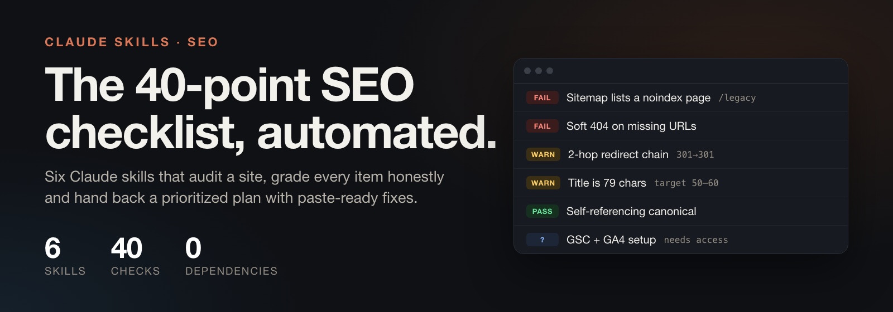
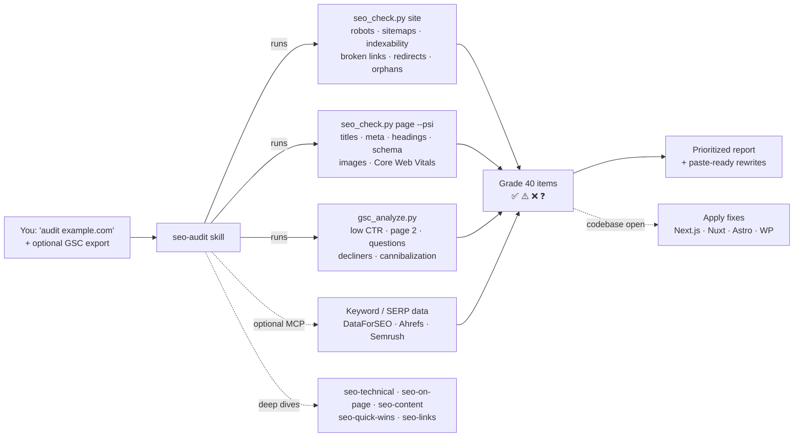

<p align="center">
  
</p>

<p align="center">
  <a href="https://github.com/Moncef12/seo-checklist-skills/actions/workflows/ci.yml"></a>
  
  
  
  
</p>

# SEO Checklist Skills for Claude

The **40-point SEO checklist** as six Claude skills. Ask Claude to *"audit my SEO"* or *"what should I fix first in Search Console?"* and it runs real checks on the site, grades every checklist item honestly, and delivers a prioritized plan with ready-to-paste fixes. With the site's codebase open, it can also apply those fixes.

Works in **Claude Code** (as a plugin) and in **Claude.ai / Claude Desktop** (as uploaded skills).

| Skill | Checklist items | Triggers on |
|---|---|---|
| **seo-audit** | All 40, orchestrated into one prioritized report | "audit my SEO", "why am I not ranking", "SEO health check" |
| **seo-technical** | GSC/GA4 · sitemaps · indexing · robots/noindex · canonicals · Core Web Vitals · mobile · JS crawlability · broken links/redirects · clean URLs · breadcrumbs · orphans · schema | indexing problems, sitemaps, canonicals, redirects, CWV, structured data |
| **seo-on-page** | Search intent · titles 50-60 chars · unique meta descriptions · headings · answer in first 2 lines · images/alt · internal links | "make this page rank", title/meta rewrites, "is this page optimized" |
| **seo-content** | Competitor keywords · high-volume/low-KD · cannibalization · merge thin pages · topic clusters · feature & use-case pages · comparison/alternatives · listicles · E-E-A-T · dateModified | keyword research, content plans, cannibalization, comparison pages |
| **seo-quick-wins** | Low CTR · `site:` title check · page-2 pages · People Also Ask · decliners | GSC exports, "quick wins", "traffic dropped" |
| **seo-links** | Brand mentions · backlink gap · "best X" lists · Reddit threads · Google Business Profile | backlinks, outreach, Reddit, local SEO |

## How it works



- **Scripts do the deterministic work.** Fetching, parsing, exact character counting and CTR math run in tested Python scripts that use only the standard library, so there's nothing to install.
- **Claude does the judgment.** It interprets search intent, prioritizes, and writes rewrites and plans.
- **Honest grading.** Anything that can't be verified from outside (GSC setup, backlink profile) is marked ❓ with the exact data needed. It's never guessed, and search volumes are never invented.
- **Works without scripts too.** In Claude.ai without code execution, or with pasted data, each skill falls back to applying the same rules by hand.

## See it in action

The repo ships a fictional SaaS site with **10 planted SEO issues** (`examples/demo_site.py`), so you can watch the whole flow locally:

```bash
make demo                                   # serves http://127.0.0.1:8799
python3 skills/seo-technical/scripts/seo_check.py site http://127.0.0.1:8799
```

| Sample output | What it shows |
|---|---|
| [`examples/sample-audit-report.md`](examples/sample-audit-report.md) | **The full deliverable.** The `seo-audit` skill run end-to-end on the demo site plus a GSC export: 40-item scorecard, priorities, rewrites. |
| [`examples/demo-site-check.md`](examples/demo-site-check.md) | Site-wide technical checker output. It catches all the planted issues: noindex page in the sitemap, soft 404, broken link, 2-hop redirect chain, cookie bounce, orphans. |
| [`examples/demo-page-check.md`](examples/demo-page-check.md) | Page-level checker: title and meta character counts, heading outline, schema, images |
| [`examples/demo-gsc-quick-wins.md`](examples/demo-gsc-quick-wins.md) | Search Console analyzer: low-CTR rows with estimated missed clicks, page-2 queries, FAQ candidates |

## Install

### Claude Code (plugin)

```bash
/plugin marketplace add Moncef12/seo-checklist-skills
/plugin install seo-checklist@seo-checklist-skills
```

Claude picks the right skill from what you ask. You can also call one directly, e.g. `/seo-checklist:seo-audit`.

### Claude Code (manual)

```bash
git clone https://github.com/Moncef12/seo-checklist-skills
cp -r seo-checklist-skills/skills/* ~/.claude/skills/
```

### Claude.ai / Claude Desktop

Download the per-skill zips from the [latest release](https://github.com/Moncef12/seo-checklist-skills/releases/latest), or build them with `make package`. Then upload them under **Settings > Capabilities > Skills**.

## Usage

```text
Audit the SEO of https://example.com - the pages that matter are /pricing and /blog.
Here's my GSC export (~/Downloads/example.com-Performance.zip). What are my quick wins?
Rewrite the title, meta and intro of app/blog/[slug]/page.tsx for "invoice software for freelancers".
/blog/invoice-guide and /templates compete for "invoice template". What do I do?
Plan a topic cluster and alternatives pages for our PM tool vs Asana and Trello.
Find link opportunities: who links to Linear and Height but not to us?
```

### Use the checkers in CI

Catch SEO regressions (noindex leaks, broken links, lost canonicals) before they ship:

```yaml
- run: python3 skills/seo-technical/scripts/seo_check.py site "$PREVIEW_URL" --crawl 200 --fail-on FAIL
```

| Script | Command | Useful flags |
|---|---|---|
| `seo_check.py` | `site URL` | `--sample N` · `--crawl N` · `--delay S` · `--workers N` · `--json` · `--fail-on FAIL\|WARN` |
| `seo_check.py` | `page URL_OR_FILE...` | `--psi` (Core Web Vitals, `PSI_API_KEY` optional) · `--json` · `--fail-on` |
| `gsc_analyze.py` | `quick-wins \| decliners \| cannibalization PATH` | `--min-impressions` · `--top` · `--swap` · `--json` |
| `lengths.py` | `--title "..." --meta "..."` | Exact character counts plus a pixel-width estimate for truncation risk |

The crawler obeys robots.txt and can be throttled with `--delay`. The GSC analyzer reads localized exports (EN/FR/DE/ES/PT/IT/NL).

## Quality

- **22 offline tests:** unit tests plus an end-to-end run against the demo site, on Python 3.9, 3.11 and 3.13 in CI.
- **Behavioral evals** with `claude plugin eval`: 7 realistic prompts, each run 3× **with and without** the plugin and graded by an LLM judge. The plugin scores **0.93 against 0.86** for the baseline, with the biggest gains on rewrites (+0.33) and consolidation plans (+0.17). The right skill fired in **18/18** SEO runs and **0/3** times on a Google Ads near-miss. Details and caveats: [`evals/RESULTS.md`](evals/RESULTS.md).
- `claude plugin validate --strict`, ruff lint, and a sync check that keeps the shared scripts identical across skills.

## Development

```bash
make sync       # copy shared/*.py into the skills that use them
make test       # unit + integration tests (offline)
make lint       # ruff
make validate   # claude plugin validate --strict
make demo       # serve the demo site
make eval       # behavioral evals, with vs. without the plugin
make package    # dist/<skill>.zip for Claude.ai
```

See [CONTRIBUTING.md](CONTRIBUTING.md) for the layout and the skill-writing conventions.

## Credits

The checklist is adapted from **"The only SEO checklist you'll need"** by [Okara](https://okara.ai). The skills, scripts and guidance in this repo are independent work and are not affiliated with or endorsed by Okara.

## License

[MIT](LICENSE) © Moncef Hassein-bey
